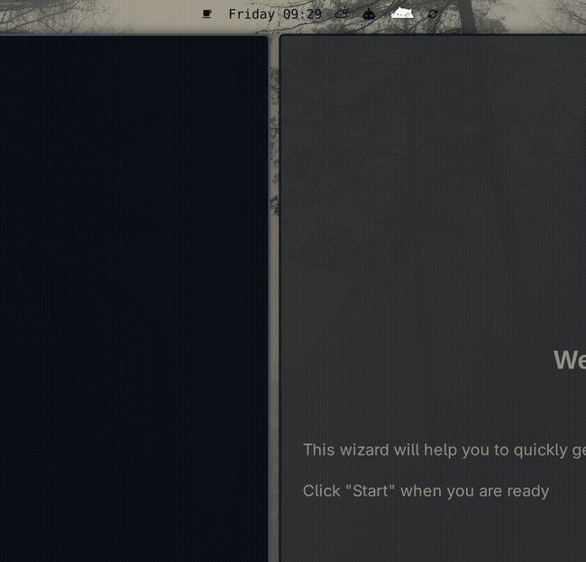
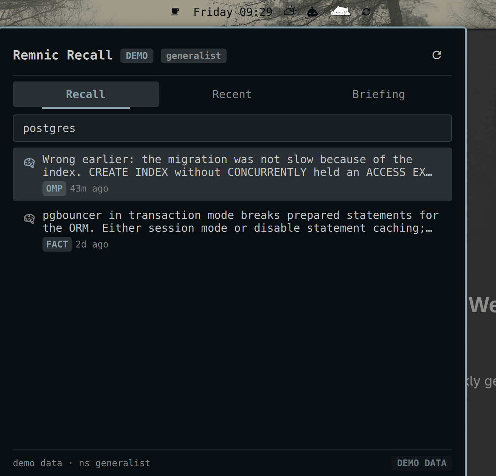
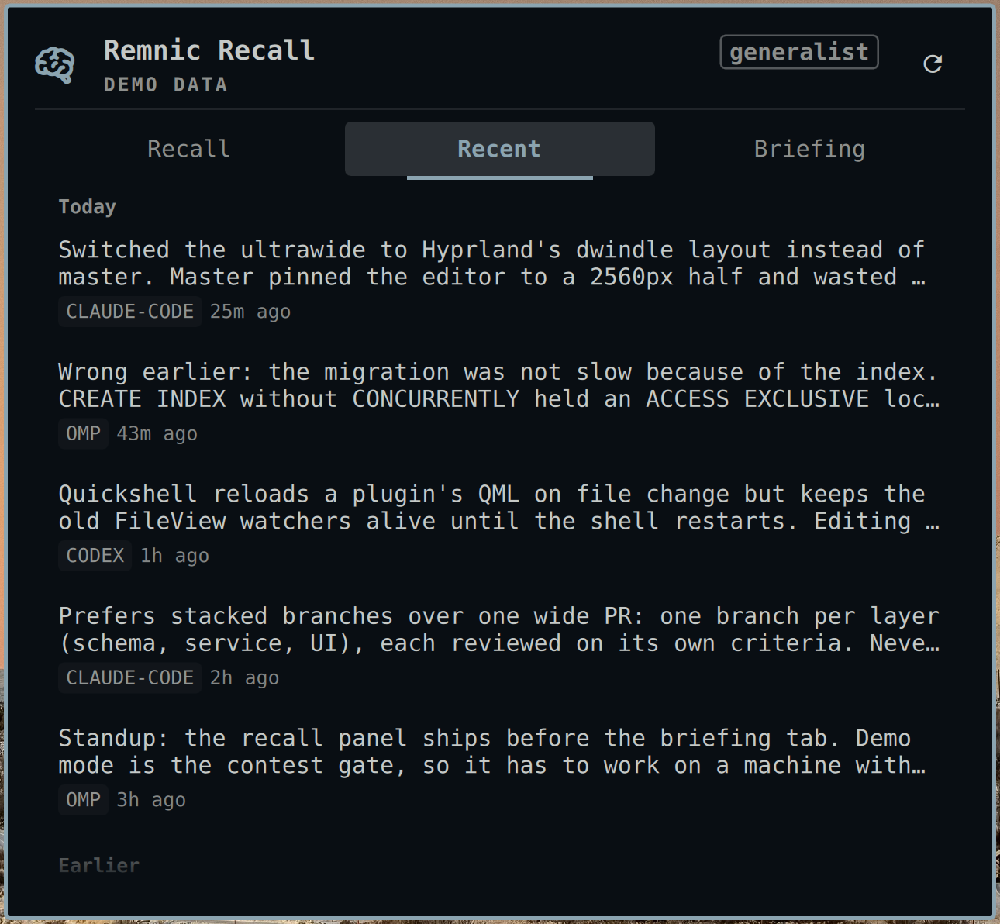
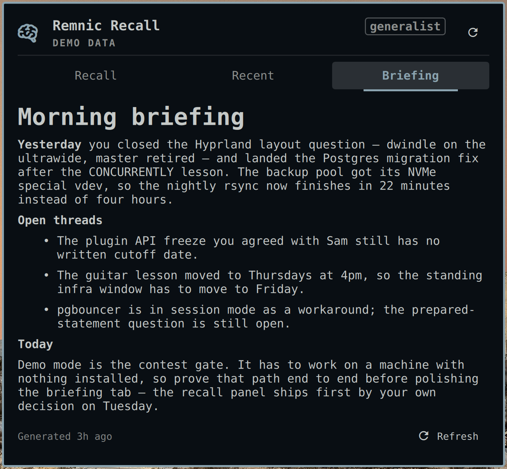
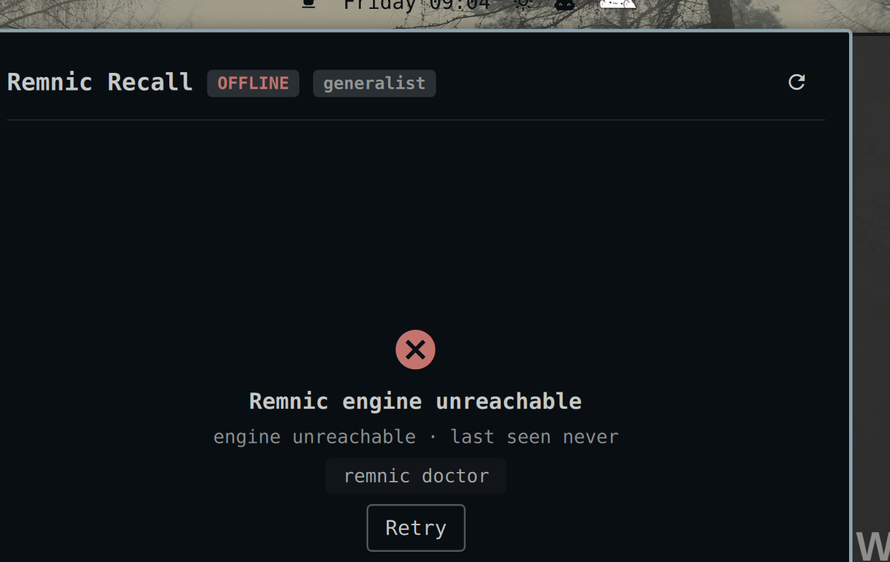

# Remnic Recall

Your AI agents' memory, in the [Omarchy](https://omarchy.org) bar.



Omarchy's marketplace tracks what your agents *cost*. Nothing tracks what they
*remember*. Remnic Recall puts the [Remnic](https://remnic.ai) memory engine on
the desktop: capture activity in the bar, recall search, recent memories, and
your morning briefing in a panel you open with one keystroke. Built by Remnic's
author.

Full-resolution recording: [docs/screenshots/demo.mp4](docs/screenshots/demo.mp4).

## What it does

- **Bar chip.** Memories captured today, a single accent pulse when a new one
  lands, a warning dot when the engine stops answering, and a `demo` badge on
  sample data. Horizontal and vertical bars both render.
- **Recall.** Search-as-you-type over the memory store, 300 ms debounce, three
  characters minimum, twenty results. A row expands to the full memory text with
  its tags. `Enter` copies that text to the clipboard.
- **Recent.** Today's captures newest first, split into Today and Earlier, each
  row carrying the agent that captured it and a relative timestamp.
- **Briefing.** The engine's daily briefing, rendered with its headings, lists,
  and emphasis intact, plus its generation time and a refresh action.
- **Send to an agent.** `Ctrl+Enter` seeds your default coding agent with the
  selected memory as its prompt. Opt-in; see
  [Sending a memory to an agent](#sending-a-memory-to-an-agent).
- **Health at a glance.** The header states whether the engine answers, how
  fresh its index is, and when the data on screen last arrived:
  `engine ok · qmd active · synced 15:26`.
- **Demo mode.** No Remnic installed? The whole UI runs on a bundled 25-memory
  sample dataset, marked `DEMO DATA` wherever fabricated rows can appear.
- **Deep links.** Open the panel pre-searched from a script or a Hyprland
  keybind.
- **Honest states.** A connecting card while the first probe is in flight, an
  offline card with a retry, and a search failure that says the engine did not
  answer rather than pretending there were no matches.
- **Theme-aware.** Every color, font, and gap comes from Omarchy's semantic
  tokens, so the chip and panel recolor the moment you switch themes.
- **Keyboard-first.** The panel takes focus on open and never needs the mouse.

| Recall | Recent | Briefing |
|---|---|---|
|  |  |  |

The panel sizes itself to its content, so a two-result search is a small card
rather than a tall box with a void under it. Results stagger in as they arrive,
tabs crossfade, a fade at the bottom edge marks a list that scrolls, and the
chip pulses once per new memory.

## Installation

```bash
omarchy plugin add https://github.com/joshuaswarren/omarchy-remnic
omarchy plugin enable io.github.joshuaswarren.remnic right
```

That is the whole install. With no engine present you get demo mode
immediately.

Removal is the mirror image: `omarchy plugin disable
io.github.joshuaswarren.remnic`, then `omarchy plugin remove
io.github.joshuaswarren.remnic`. The plugin writes nothing outside Omarchy's own
config, so nothing else is left behind. Your memory store belongs to Remnic and
is never touched, on removal or at any other time.

## Requirements

- Omarchy 4 (Quattro shell). Developed and verified on `4.0.0.r1758`.
- `wl-clipboard`, for the copy action. Omarchy ships it.
- Optional, for live data: a [Remnic](https://remnic.ai) engine. Installation
  and setup are documented at [remnic.ai](https://remnic.ai) and in the
  [joshuaswarren/remnic](https://github.com/joshuaswarren/remnic) repository.
  Any daemon serving the `/engram/v1` read API works.

A standard local Remnic install needs no configuration here: the plugin looks
for the daemon at `http://127.0.0.1:4318` and a token in
`~/.remnic/tokens.json`, which is where Remnic puts them.

## Settings

Settings live inline on the plugin entry in `~/.config/omarchy/shell.json`,
under the `bar.layout` section. They hot-apply; no shell restart.

```json
{
  "id": "io.github.joshuaswarren.remnic",
  "daemonUrl": "http://127.0.0.1:4318",
  "token": "",
  "tokenPath": "~/.remnic/tokens.json",
  "remnicCommand": "remnic",
  "namespace": "",
  "pollSeconds": 60,
  "recentLimit": 30,
  "demoMode": "auto",
  "allowInsecureToken": false,
  "sendToAgent": false
}
```

| Setting | Meaning |
|---|---|
| `daemonUrl` | The Remnic access daemon. A remote daemon works; use a token that daemon issued. |
| `token` / `tokenPath` | An inline token wins; otherwise the first entry of the token store is used. |
| `allowInsecureToken` | The token is sent only to `https://` or a loopback address. Set `true` to also send it over plaintext HTTP to a remote daemon. Without it the plugin still runs, unauthenticated. |
| `namespace` | Empty uses the daemon's default namespace. |
| `remnicCommand` | The briefing binary. A bare name resolves on `PATH`; an absolute path is taken as-is. |
| `pollSeconds` | Capture-count poll interval. Floored so a hand edit cannot spin. |
| `recentLimit` | How many memories the Recent tab holds. |
| `demoMode` | `auto` (demo only when no engine answers), `on`, `off`. |
| `sendToAgent` | Enables `Ctrl+Enter`. Off by default. |

## Usage

**Left-click** the chip to toggle the panel on Recall. **Right-click** opens
Recent.

| Key | Action |
|---|---|
| `Tab` / `Shift+Tab` | cycle tabs |
| `↑` `↓` | move the selection |
| `→` `←` | expand and collapse a row |
| `Enter` | copy the memory text |
| `Ctrl+Enter` | send the memory to your default agent (when enabled) |
| `Esc` | close the panel |

Deep-link from a script or a Hyprland keybind:

```bash
omarchy-shell shell toggle io.github.joshuaswarren.remnic '{"tab":"recall","query":"postgres"}'
omarchy-shell shell summon io.github.joshuaswarren.remnic '{"tab":"briefing"}'
```

The payload takes `tab` (`recall` | `recent` | `briefing`) and an optional
`query`.

## States

| State | Chip | Panel |
|---|---|---|
| Live | glyph + today's count | tabs with live data; header reads `engine ok · qmd <state> · synced <time>` |
| Connecting | glyph only | a connecting card while the first probe runs |
| Offline | warning dot, tooltip shows last-seen | offline card with a `remnic doctor` hint and Retry |
| Demo | `demo` badge | `DEMO DATA` mark, bundled sample dataset |



## Sending a memory to an agent

`Ctrl+Enter` hands the selected memory's text to `omarchy-agent-prompt`, which
opens your configured default agent with that text as its prompt. It is off
until you set `sendToAgent: true`, for one specific reason:
`omarchy-agent-prompt` takes the prompt as a command-line argument, so while the
agent runs, the memory text is visible in the process list to any other process
running as you. Nothing leaves the machine, but the text does leave the panel.
That is a fair trade for some people and not for others, so it is your call to
make rather than a default. The seed is length-clamped, and nothing is sent
without that explicit keystroke.

## Security and privacy

Memory content is sensitive, so the plugin is read-only by contract and states
exactly what it does.

- **Network.** Live reads go to the Remnic daemon's existing HTTP API,
  `GET /engram/v1/health` and `GET /engram/v1/memories`. No mutating endpoint is
  ever called. `daemonUrl` is the only host contacted. No telemetry.
- **Credentials.** The bearer token is read from disk, sent only as an
  `Authorization` header, and never logged, rendered, or placed in a URL, an
  argument vector, or the clipboard. It is withheld unless the destination is
  loopback or HTTPS, which `allowInsecureToken` exists to override on purpose.
- **Processes.** Exactly three, each a fixed argument array with no shell:
  `remnic briefing --format json`; `wl-copy`, with the memory text on stdin and
  only on an explicit `Enter`; and `omarchy-agent-prompt`, only on `Ctrl+Enter`
  and only when you have enabled it. Audit them with
  `grep -n "Process {" -r .`. None of the three can create, forget, or migrate a
  memory. Clicking the chip also asks the *host* to run `omarchy-shell shell
  toggle …` through Omarchy's own `bar.run`, which is how every third-party
  widget opens its panel.
- **Rendering.** Memory text renders as plain text. The briefing is the one
  markdown surface and is treated as untrusted, because the engine assembles it
  out of memory content: inline HTML, images, link syntax, and tables are all
  neutralized, so no memory can embed markup or trigger a remote fetch. A bare
  URL may still render as an inert link; the plugin installs no link handler, so
  it cannot be opened. Headings, emphasis, and lists survive.
- **Disk.** Nothing is written, anywhere.
- **Bounds.** Responses are size-capped before parsing, the memory array is
  length-capped, and every daemon-supplied string is length-clamped before it
  reaches text layout, so a slow or hostile daemon cannot stall or exhaust the
  shell process.

One caveat applies to every Omarchy shell plugin, not only this one: plugins run
unsandboxed in a single process, so any installed plugin can rewrite
`shell.json`, including this plugin's settings. Remnic Recall grants a neighbor
nothing it could not already do directly.

## Troubleshooting

- **The panel says offline but the daemon is running.** Check `daemonUrl`, and
  that the token was issued by *that* daemon:
  `curl -H "Authorization: Bearer <token>" <daemonUrl>/engram/v1/health`.
- **The briefing tab is missing in live mode.** The daemon's briefing route
  answered with nothing renderable and the CLI fallback failed — the `remnic`
  binary is not on the shell's `PATH`, or the briefing command failed. Run
  `remnic briefing --format json` in a terminal to see the error.
- **Everything shows demo data.** The plugin found no daemon response and no
  token. Set `demoMode` to `off` to see the offline card instead, or configure
  `daemonUrl` and the token.
- **`Ctrl+Enter` does nothing.** `sendToAgent` is `false`, which is the default.

## Development

Setup, the hot-reload loop, and the log commands are in
[docs/DEVELOPMENT.md](docs/DEVELOPMENT.md). The frozen design contract is in
[docs/DESIGN.md](docs/DESIGN.md); the spec and acceptance criteria are in
[docs/REQUIREMENTS.md](docs/REQUIREMENTS.md).

## License

[MIT](LICENSE)
